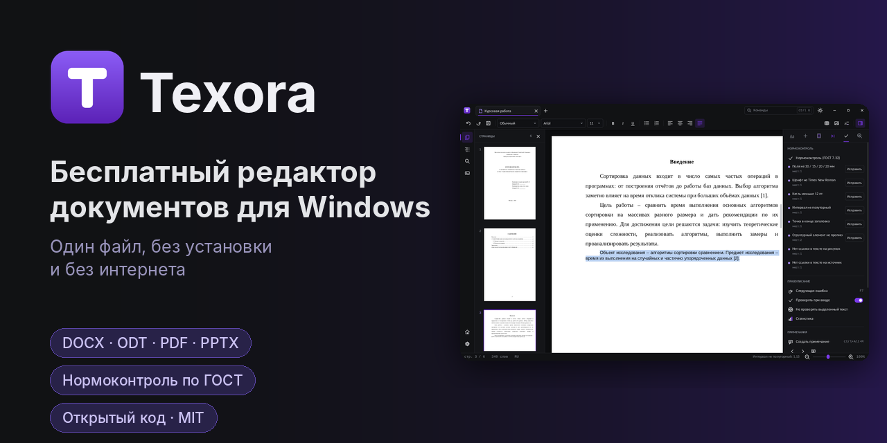
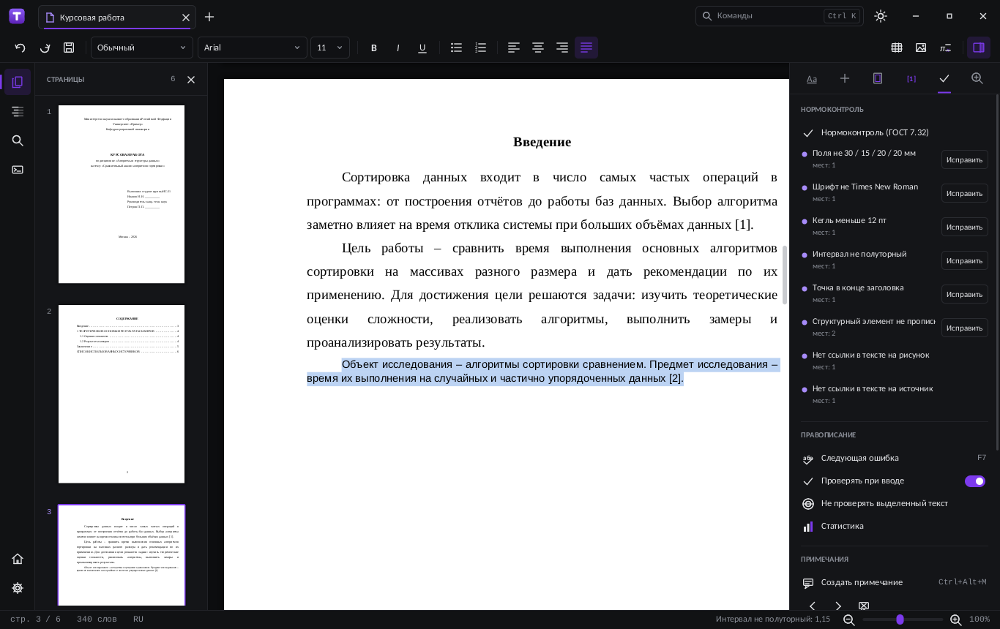
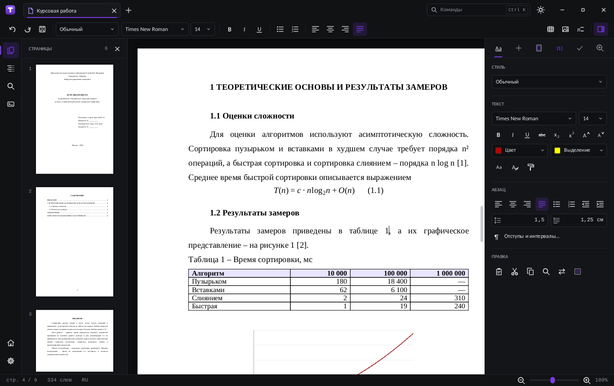
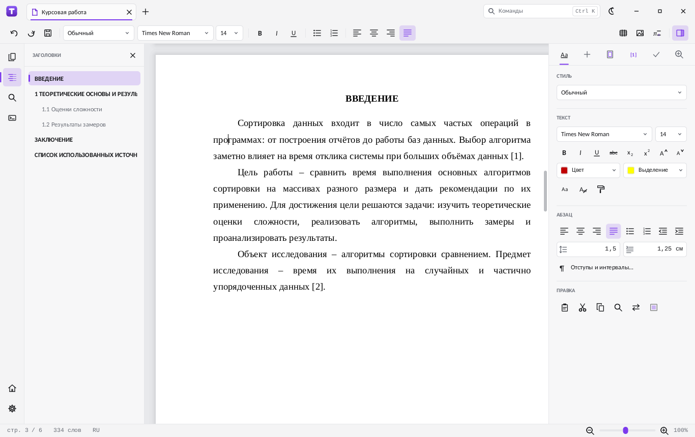
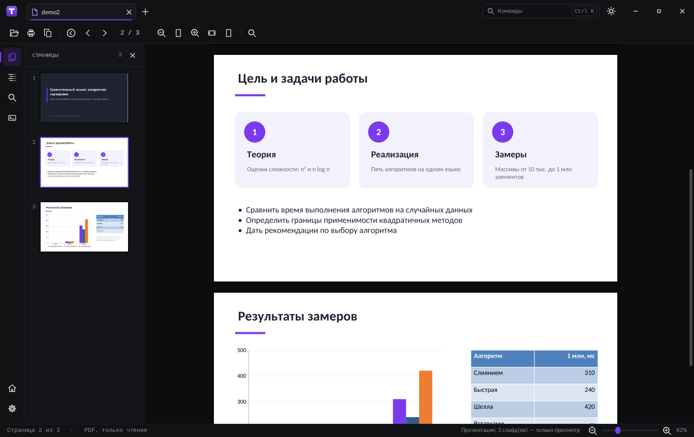

<p align="center">
  
</p>

<h1 align="center">Texora</h1>

<p align="center">
  Бесплатный текстовый редактор для Windows: один файл, без установки, без интернета.<br>
  Сделан для курсовых, дипломов и рефератов — с нормоконтролем по ГОСТ.
</p>

<p align="center">
  <a href="https://github.com/FallenKeK/Texora/releases/latest"><b>⬇ Скачать Texora.exe</b></a>
  &nbsp;·&nbsp; Windows 10 и 11, 64 бита &nbsp;·&nbsp; MIT
</p>

## Что умеет

- **Нормоконтроль по ГОСТ 7.32.** Проверяет поля, шрифт, интервал, абзацный отступ, заголовки, подписи рисунков и таблиц,
  ссылки на рисунки, таблицы и источники. Показывает, где нарушение, и исправляет целую группу одной кнопкой.
- **Шаблоны работ.** Курсовая, диплом, реферат, доклад, деловое письмо, отчёт. Настоящее оглавление, автонумерация
  «Рисунок 1.2» и «Таблица А.1», перекрёстные ссылки.
- **Список литературы по ГОСТ Р 7.0.100.** Книги, статьи, сайты, диссертации, стандарты, патенты. Импорт из BibTeX и RIS,
  поиск и слияние повторов.
- **Формулы** с живым предпросмотром: дроби, интегралы, суммы, матрицы, системы уравнений, нумерация справа.
- **Форматы.** Открывает и сохраняет docx, odt, rtf, txt; читает doc; экспортирует PDF с поиском и закладками.
  Читалка PDF (в том числе сканы) и **просмотр презентаций .pptx**.
- **Рецензирование.** Исправления, примечания, сравнение двух версий документа.
- **Остальное:** колонки, сноски, колонтитулы, разделы, обтекание картинок, орфография и переносы для русского и английского,
  автосохранение и восстановление после сбоя, тёмная и светлая темы, палитра команд на Ctrl+K.

## Как выглядит

<p align="center">
  <br>
  <sub>Нормоконтроль: замечания по группам, переход к месту и исправление одной кнопкой</sub>
</p>

<p align="center">
  <br>
  <sub>Редактор: формулы, таблицы, рисунки, миниатюры страниц</sub>
</p>

<p align="center">
  <br>
  <sub>Светлая тема и панель заголовков</sub>
</p>

<p align="center">
  <br>
  <sub>Просмотр презентаций .pptx</sub>
</p>

## Установка

1. Скачайте **Texora.exe** со страницы [последнего релиза](https://github.com/FallenKeK/Texora/releases/latest).
2. Запустите. При первом запуске Texora спросит, ставить ли ярлыки и «Открыть с помощью» (интернет не нужен). Ответ «Нет» — просто работать из этого файла.
3. Exe пока без цифровой подписи, поэтому Windows может показать «Windows защитила ваш компьютер»:
   нажмите «Подробнее» → «Выполнить в любом случае». Исходный код открыт, внутри нет ничего лишнего.

Новые версии Texora находит и ставит сама (раз в день; выключается в настройках).

## Честно о границах

Это молодой проект одного автора. Вёрстка сверялась с LibreOffice, настоящего Word под рукой не было, поэтому
на сложных документах страницы могут расходиться с Word на строку-другую. Нет: макросов, совместной работы,
проверки грамматики, концевых сносок и фигур SmartArt. Нашли ошибку или нужна функция — пишите в
[Issues](https://github.com/FallenKeK/Texora/issues).

## Для разработчиков

Go, только стандартная библиотека, без cgo; под Windows окно и шрифты — через syscall. Устройство описано в
[ARCHITECTURE.md](ARCHITECTURE.md).

## Сборка

```sh
GOOS=windows GOARCH=amd64 go build -ldflags "-H windowsgui -s -w" -o Texora.exe .
```

Значок, манифест и версия exe лежат в `rsrc_windows_amd64.syso`; после смены `AppVersion` (ui.go):

```sh
go run . mkres
cd assets && llvm-windres -c 65001 --target=pe-x86-64 -i app.rc -O coff -o ../rsrc_windows_amd64.syso
```

## Проверка

```sh
go test ./...          # автотесты (на Linux — со сценариями правки и кругового сохранения)
go run . interactive   # и другие сценарии: features, captions, eqtest, scenario, pdftest, perf — см. ARCHITECTURE.md
```

На Linux программа не открывает окно, а рисует интерфейс в PNG (ttf.go), поэтому её можно проверять без Windows.
CI (`.github/workflows`) на windows-latest собирает exe, запускает его, снимает скриншоты и гоняет тесты.

## Автор

FallenKeK — [github.com/FallenKeK](https://github.com/FallenKeK).

## Лицензия

[MIT](LICENSE). Вшитые словари орфографии и переносов взяты из LibreOffice и распространяются на своих условиях —
см. [NOTICES.md](NOTICES.md).
